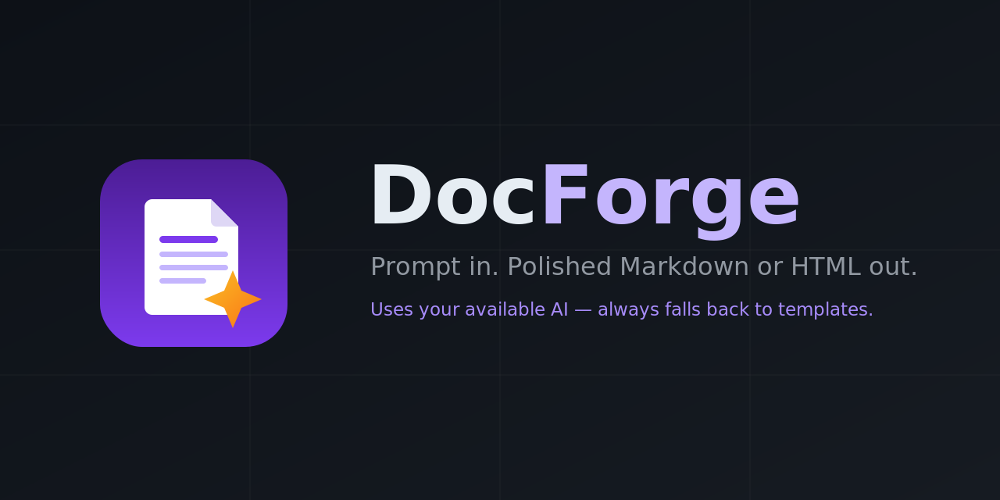
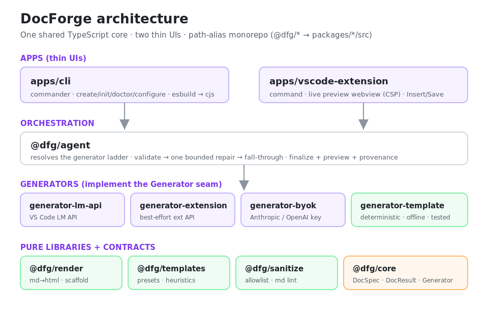
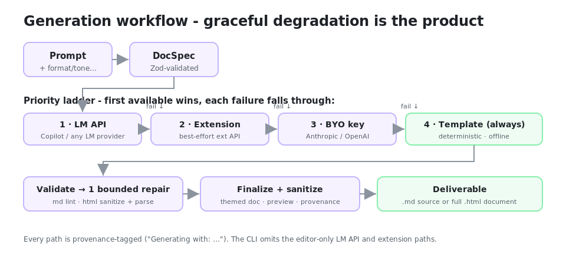

<p align="center">
  
</p>

<p align="center">
  <a href="https://github.com/aniketsoni1/doc-forge/actions/workflows/ci.yml"></a>
  
  
  = 20" />
  
</p>

# DocForge

**Type a prompt, get a polished `.md` or `.html` file - with a live preview.** DocForge is a
deterministic-first document generator. It uses whatever AI capability you already have and **always
has a working offline fallback**, so it never hard-fails just because no AI is installed.

One shared TypeScript core powers two thin UIs: a cross-platform **CLI** (`docforge`) and a **VS Code
extension**.

## Why DocForge

- **Graceful degradation is the product.** Every failure - no model, no key, quota, offline - falls
  through to the next generator and ends at a deterministic template. You always get a document.
- **Provenance is never a mystery.** DocForge always tells you which generator ran
  (`Generating with: Copilot (VS Code LM API)` / `BYO key` / `Built-in templates`).
- **Safe by construction.** All model HTML is sanitized against an allowlist before it is written or
  shown, and every webview uses a strict Content-Security-Policy.
- **Local-first.** The CLI and the template generator work fully offline. AI/network is opt-in and
  disclosed. No telemetry.

## Feature overview

- Prompt → **Markdown** or sanitized, themed, printable **HTML**
- Six deterministic presets: `readme`, `blog`, `report`, `landing`, `changelog`, `letter`
- Prompt heuristics (title, sections, feature lists) drive the template path
- A single `Generator` seam with a transparent **priority ladder**
- Live preview with **streaming drafts**, Insert / Save / Copy, and **cancellable** generation
- **Selection-based editing**: 15 transforms, four of which run fully offline
- **Section-level regeneration** driven by a real Markdown/HTML parser, not string replacement
- Diff + approval before any overwrite, rewrite, or regeneration
- Typed provider errors: every fallback reports *what* failed and *what to do next*
- Bring-your-own-key (Anthropic / OpenAI) in both the CLI and the extension
- Token, cost, and duration reporting - always labelled as estimates when estimated

## The generator ladder

DocForge resolves the best available generator in this order and uses the first one that works:

| # | Generator | Where | Notes |
| - | --------- | ----- | ----- |
| 1 | **VS Code Language Model API** | Editor | Sanctioned, vendor-neutral (Copilot + others) |
| 2 | **Compatible AI extension** | Editor | Best-effort, via a documented `generateDocument` API |
| 3 | **Bring-your-own-key** | CLI + Editor | Anthropic / OpenAI; key in SecretStorage / env |
| 4 | **Built-in templates** | Everywhere | Deterministic, offline, always available - the tested path |

The CLI omits the editor-only paths (1 and 2). If a generator errors or produces output that a single
bounded repair pass can't fix, DocForge falls through to the next one.

## Quick start

```bash
git clone https://github.com/aniketsoni1/doc-forge.git
cd docforge
npm install
npm run verify          # typecheck (src + ext) + lint + tests + smoke

# Generate from source (no build needed in dev)
npm run docforge -- create "README for a CLI tool called Acme with features: fast, tiny, typed" --no-ai
```

## CLI usage

```bash
# Markdown to stdout, offline template generator
docforge create "Report on Q3 sales performance" --no-ai

# Themed, sanitized HTML written to a file (extension inferred)
docforge create "Landing page for a note app" --format html --template landing --output landing

# Use your own key (falls back to templates automatically if unset)
export ANTHROPIC_API_KEY=sk-...
docforge create "Changelog for v2.0" --template changelog

# Environment & availability
docforge doctor
```

Key flags for `create`: `--format md|html`, `--template <id>`, `--tone`, `--length`, `--title`,
`--model`, `--output <path>`, `--no-ai` (force templates), `--non-interactive`, `--force`. Overwriting
an existing file shows a diff and asks for confirmation.

Other commands: `docforge init` (write `docforge.config.json`), `docforge doctor`, `docforge configure`.

### Rewriting existing documents

```bash
# What can it do? Offline transforms are marked.
docforge transforms

# See a document's structure
docforge outline README.md

# Apply an offline transform - no key, no network, shows a diff first
docforge rewrite notes.md --transform to-bullets --no-ai

# Rewrite one section only, leaving the rest byte-identical
docforge rewrite README.md --section installation --instruction "add a Windows example" --write
```

`rewrite` prints a diff and, without `--write`, only shows the result. With `--write` it asks for
confirmation, and in a non-interactive context it refuses unless given `--force`, so automation
cannot quietly rewrite files.

### Project configuration

`docforge init` writes a `docforge.config.json` that DocForge reads from the working directory on
every run:

```json
{
  "defaultFormat": "md",
  "defaultTone": "neutral",
  "defaultLength": "medium",
  "aiEnabled": false,
  "provider": "anthropic",
  "model": "claude-3-5-sonnet-latest",
  "requestTimeoutMs": 60000
}
```

Precedence is **defaults → config file → environment → command-line flags**, so the environment
always beats a checked-in project file. Unknown keys are reported rather than ignored, and a
malformed file degrades to the defaults with a warning instead of failing the run.

## VS Code extension

Install the VSIX (see below), then run **DocForge: New Document from Prompt** (`Ctrl/Cmd+Alt+D`):

1. Describe the document.
2. Pick a format and a generator (Auto / a specific model / Built-in templates).
3. Review the live, themed, sanitized preview. Generation is cancellable throughout.
4. **Insert** into the editor, **Copy**, or **Save** to disk. **Regenerate** to try again.

Saving over an existing file offers a side-by-side **diff** before overwriting. If a generator fails,
the preview reports which one and why, and **DocForge: Run Diagnostics** shows the full attempt trail.

Two editing commands work on documents you already have:

- **DocForge: Improve Selected Text** (`Ctrl/Cmd+Alt+I`) - select text, pick a transform, review the
  diff, then accept, reject, or regenerate. Four transforms (bullets ↔ prose, add headings,
  executive summary) are deterministic and need no provider at all; the picker says which.
- **DocForge: Regenerate Section** - pick a heading from the outline (the one under your cursor is
  offered first), optionally add an instruction, and rewrite just that section. Neighbouring
  sections are preserved exactly, because the replacement is spliced at parsed character offsets
  rather than matched by string.

Both preserve the original until you accept, and both abandon the edit if the document changed while
the preview was open.

Untrusted workspaces use the offline template generator only. Set a BYO key with **DocForge: Set API
Key** (stored in SecretStorage, never in settings).

## Configuration

CLI (environment variables, local-only):

| Variable | Purpose |
| --- | --- |
| `ANTHROPIC_API_KEY` / `OPENAI_API_KEY` / `DOCFORGE_API_KEY` | Enable BYO-key generation |
| `DOCFORGE_PROVIDER` | `anthropic` or `openai` |
| `DOCFORGE_MODEL` | Model id |
| `DOCFORGE_FORMAT` | Default `md` or `html` |

Extension settings, grouped under **Generation**, **Providers**, and **Reporting**:
`docforge.defaultFormat`, `docforge.tone`, `docforge.length`, `docforge.enableAi`,
`docforge.provider`, `docforge.model`, `docforge.requestTimeoutMs`, `docforge.pricing`.

Cost figures are **always estimates** derived from an indicative price table; override it with
`docforge.pricing` (extension) or the `pricing` key in `docforge.config.json` (CLI).

## Privacy & security

Local-first by default; the template generator is fully offline. AI generators are opt-in and
disclosed, and DocForge respects Workspace Trust. **All model output is untrusted:** generated HTML is
sanitized (scripts, inline handlers, and unsafe URLs stripped) before it is written or shown, and every
webview sets a strict CSP. Keys live in SecretStorage (extension) or environment variables (CLI) and
are never written to settings or logs. See [`SECURITY.md`](SECURITY.md).

## Architecture

Path-alias monorepo (`@dfg/* → packages/*/src`); no per-package build in dev - tsx, Vitest, and esbuild
resolve the aliases directly.



Generation workflow (graceful degradation):



More detail in [`docs/ARCHITECTURE.md`](docs/ARCHITECTURE.md).

```
apps/       cli/  vscode-extension/
packages/   core  render  templates  sanitize  configuration
            reporting  agent  testing  diff
            document-model  transforms
            generator-template  generator-byok
samples/  docs/  assets/  scripts/  .github/
```

## Examples

Genuine output from the deterministic template path (regenerate with `npx tsx scripts/emit-samples.mjs`):

```markdown
# Acme

> This document covers a CLI tool called Acme.

## Overview
...
## Features

- fast
- tiny
- typed

## Installation
...
```

Open these in a browser to see the real rendered output:

- [`samples/q3-report.html`](samples/q3-report.html) - themed, sanitized HTML document
- [`samples/preview-webview.html`](samples/preview-webview.html) - the extension's actual CSP preview page
- [`samples/acme-readme.md`](samples/acme-readme.md), [`samples/acme-changelog.md`](samples/acme-changelog.md)

> **On UI screenshots:** the icon, hero, logo, and diagrams above are original, reproducibly generated
> assets. Screenshots of the running extension inside the VS Code UI require a live editor session -
> a precise, repeatable capture checklist is in [`docs/CAPTURE.md`](docs/CAPTURE.md). This repository
> deliberately ships **no placeholder or mocked UI images**.

## Install the VS Code extension (from VSIX)

```bash
npm run build:ext
npm run package:vsix       # -> artifacts/docforge-<version>.vsix (+ .sha256)
npm run verify:vsix        # audits the packaged contents
code --install-extension artifacts/docforge-0.1.1.vsix
```

## Limitations

- The template generator produces a well-structured **scaffold** with placeholder prose; rich drafting
  comes from an AI generator.
- The "compatible AI extension" path is best-effort and only activates for a documented
  `generateDocument` API.
- VS Code UI screenshots and the demo GIF are produced manually (see `docs/CAPTURE.md`); they are not
  auto-captured in this environment.
- PDF/DOCX export is on the roadmap, not yet implemented.
- Streaming shows a live draft in the preview. Whether output actually arrives incrementally depends
  on the provider: the VS Code LM API streams, and the BYO-key path currently returns in one piece,
  so its draft appears all at once.
- Eleven of the fifteen selection transforms need an AI provider. The four deterministic ones are
  structural rather than semantic - `bullets-to-prose` rearranges punctuation, it does not rewrite
  meaning - and the picker labels which is which rather than silently producing a worse result.
- The executive-summary transform is *extractive*: it selects existing sentences rather than
  synthesising new ones, so nothing it emits is text the author did not write.
- Token and cost figures are **estimates**. They come from a built-in indicative price table that can
  go stale; override it rather than treating the number as a bill. Counts are marked `~` when
  DocForge estimated them because the provider omitted usage.
- Cancellation is honoured by the BYO-key and VS Code LM API generators. The compatible-extension
  path exposes no cancellation token, so a cancel there discards the result rather than aborting the
  underlying request.
- The extension's `vscode`-importing modules are not unit-tested; its pure modules are. There is no
  end-to-end editor test harness yet.

## Roadmap

A full audit and phased plan live in [`docs/AUDIT.md`](docs/AUDIT.md) and
[`docs/PLAN.md`](docs/PLAN.md). Phases 1 and 2 are done. Next up:

- A central Document Studio panel
- Workspace-aware generation with explicit, previewed, redacted context
- Preset & prompt library shareable across a team
- Export beyond md/html (PDF / DOCX)
- Prompt caching and local generation history
- Validation and accessibility checks in the Problems panel

## Contributing

See [`CONTRIBUTING.md`](CONTRIBUTING.md) and [`CODE_OF_CONDUCT.md`](CODE_OF_CONDUCT.md). Run
`npm run verify` before opening a PR.

## License

[Apache-2.0](LICENSE) © `aniketsoni1`
